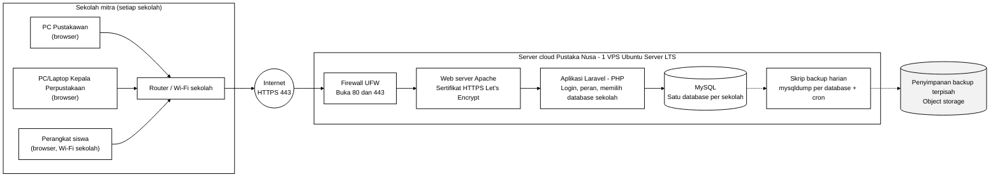

# Deployment Diagram (Draf) — Pustaka Nusa

**Disusun oleh:** Zahro Athirah (F1E124006), Network (+QA)

Diagram dibawah menunjukkan penempatan komponen pada perangkat dan jalur komunikasinya untuk model layanan.

## Keterangan komponen

| Komponen | Fungsi | Status keputusan |
|---|---|---|
| Browser (PC pustakawan, kepala perpustakaan, perangkat siswa) | Satu-satunya yang dibutuhkan sekolah, tanpa instalasi | Tetap |
| Firewall UFW | Hanya port 80/443 terbuka; SSH dibatasi | Usulan Network |
| Apache + HTTPS | Melayani halaman web dan mengenkripsi lalu lintas | Apache (mengikuti Phase D dan lingkungan pengembangan tim) |
| Laravel (PHP) | Logika aplikasi, login, peran, memilih database sekolah | Versi laravel 12.8.1 |
| MySQL | Satu database terpisah untuk tiap sekolah | Versi... |
| Skrip backup | Dump harian per database, unggah ke penyimpanan terpisah, uji restore di P15 | Usulan Network (F10) |