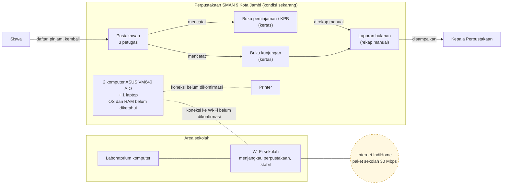

# Topologi As-Is — Perpustakaan SMAN 9 Kota Jambi

**Disusun oleh:** Zahro Athirah (F1E124006), Network (+QA)

## Tujuan dan ruang lingkup

Dokumen ini menggambarkan kondisi teknologi perpustakaan **saat ini** di SMAN 9 Kota Jambi, sebagai mitra pilot Pustaka Nusa. SMAN 9 dipakai sebagai **contoh nyata**, namun kondisi sekolah lain berbeda-beda, sehingga bagian 4 merangkum perbedaan itu dalam tiga profil kesiapan.

## Sumber data dan status

| Informasi | Data | Status |
|---|---|---|
| Pencatatan | Manual: buku peminjaman/KPB, buku kunjungan, laporan bulanan direkap manual; belum ada server, aplikasi, maupun basis data | Terkonfirmasi |
| Perangkat kerja | 2 komputer dan 1 laptop | Terkonfirmasi |
| Jenis komputer | ASUS VM640 (All-in-One PC) | Terkonfirmasi |
| Wi-Fi di perpustakaan | Terjangkau di ruang perpustakaan dan stabil | Terkonfirmasi |
| ISP sekolah | IndiHome | Terkonfirmasi |
| Kecepatan internet | Paket sekolah **30 Mbps** (dipakai bersama seluruh sekolah). **Kecepatan yang diterima di perpustakaan belum diukur** (speed test) | Sebagian |
| Printer | Ada | Terkonfirmasi |
| Petugas perpustakaan | 3 orang | Terkonfirmasi |
| Pola peminjaman | Puncak di awal semester, terutama buku bahan ajar siswa| Terkonfirmasi |
| Jumlah siswa | ± 700–800 (21 ruang kelas × asumsi 36 siswa) | **Asumsi** |

## Diagram topologi as-is (SMAN 9)

Garis **putus-putus** = belum dikonfirmasi. lingkaran  **kuning putus-putus** = belum diukur.

**Penjelasan** Seluruh data perpustakaan masih tersimpan di buku kertas dan direkap manual, walaupun perpustakaan sudah memiliki perangkat komputer, printer, dan Wi-Fi sekolah yang menjangkau ruangannya. Belum ada server maupun aplikasi, sehingga tidak ada jalur data digital antara siswa, pustakawan, dan kepala perpustakaan. Perangkat dan jaringan yang ada belum dipakai untuk mencatat peminjaman.

## Profil kesiapan sekolah (hipotesis, untuk menyeluruhkan as-is)

Kondisi tiap sekolah berbeda. Karena Pustaka Nusa adalah layanan di cloud, sekolah hanya membutuhkan **satu perangkat dengan browser dan koneksi internet**. Perbedaan antar sekolah dirangkum dalam tiga profil:

| Profil | Ciri | Yang perlu disiapkan sebelum onboarding |
|---|---|---|
| **A - Siap** | Ada PC/laptop perpustakaan dan internet stabil | Tidak ada, langsung dibuatkan akun |
| **B - Setengah siap** | Ada PC/laptop, tetapi internet lemah atau tidak sampai ke perpustakaan | Perbaikan akses (router/Wi-Fi tambahan atau hotspot sementara) |
| **C - Belum siap** | Tidak ada PC/laptop khusus perpustakaan | Pinjam laptop pustakawan atau pengadaan 1 PC |

## Persyaratan minimum sisi sekolah (usulan)

| Aspek | Persyaratan |
|---|---|---|
| Perangkat | 1 PC/laptop untuk pustakawan |
| Browser | Chrome, Firefox, atau Edge versi terbaru |
| Internet | Tersedia di ruang perpustakaan |
| Printer | Opsional |
| Penanggung jawab teknis sekolah | 1 orang |

## Daftar untuk memeriksa kesiapan onboarding sekolah

- [ ] Ada PC/laptop untuk pustakawan?
- [ ] Ada internet di ruang perpustakaan?
- [ ] Ada printer (laporan dan kartu)?
- [ ] Siapa penanggung jawab teknis di sekolah?
- [ ] Siapa pustakawan dan kepala perpustakaan yang akan memegang akun?
- [ ] Data lama (anggota dan buku) dalam bentuk apa (kertas atau Excel)?

## Celah menuju to-be (gap)

| Kode | Aspek | As-is | To-be | Celah |
|---|---|---|---|---|
| G-01 | Pencatatan data | Buku kertas | Basis data terpusat di cloud | Belum ada sistem digital |
| G-02 | Perangkat kerja | 2 komputer + 1 laptop (OS/RAM belum diketahui) | 1 PC/laptop dengan browser modern | Perlu dipastikan versi browser |
| G-03 | Akses internet | Paket sekolah 30 Mbps, Wi-Fi stabil; kecepatan di perpustakaan belum diukur | Internet stabil di perpustakaan | Perlu speed test di perpustakaan |
| G-04 | Laporan | Rekap manual | Laporan otomatis dari sistem | Belum ada |
| G-05 | Backup | Tidak ada (kertas) | Backup harian di cloud | Belum ada |
