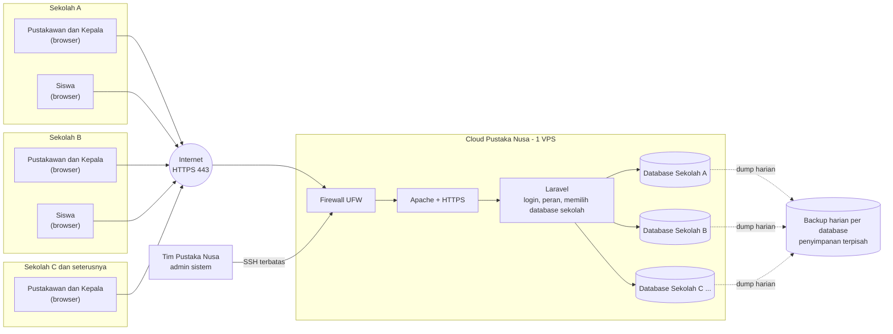

# Topologi To-Be — Platform Pustaka Nusa (SaaS Multi-Sekolah)

**Disusun oleh:** Zahro Athirah (F1E124006), Network (+QA)

Menggambarkan rancangan teknologi target Pustaka Nusa: satu platform di cloud yang dipakai banyak perpustakaan sekolah lewat browser sebagai layanan.

## Diagram topologi to-be

## Komponen dan fungsinya

| Komponen | Fungsi | Status |
|---|---|---|
| Browser di perangkat sekolah | Satu-satunya yang dibutuhkan sekolah | Tetap |
| Firewall UFW | Hanya port 80/443 terbuka untuk publik; SSH dibatasi untuk admin | Usulan Network |
| Apache + HTTPS | Melayani halaman web dan mengenkripsi lalu lintas | Apache |
| Laravel | Login, peran, logika aplikasi | Versi laravel 12.8.1 |
| MySQL | Basis data, satu database terpisah untuk tiap sekolah | Versi |
| Backup harian | Salinan tiap database di penyimpanan terpisah, uji restore di P15 | Usulan Network |
| Tim Pustaka Nusa | Pemeliharaan server lewat SSH terbatas | Usulan Network |

## Akses menurut peran

| Peran | Perangkat | Akses |
|---|---|---|
| Siswa/anggota | Ponsel atau komputer sekolah | Cari katalog, lihat status buku |
| Pustakawan | PC/laptop perpustakaan | Kelola anggota, buku, peminjaman, pengembalian, denda |
| Kepala perpustakaan | PC/laptop | Laporan dan pengelolaan akun |
| Admin sistem (tim kami) | Laptop tim | Pemeliharaan server |

## Pemisahan data antar sekolah

Setiap sekolah memiliki database tersendiri pada server yang sama. Aplikasi memilih database sesuai sekolah yang sedang login, sehingga data satu sekolah tidak tercampur dengan sekolah lain.

Dampaknya pada infrastruktur:

| Aspek | Dampak |
|---|---|
| Isolasi data | Lebih kuat daripada satu database bersama dan mendukung KPI K3 |
| Penambahan sekolah baru | Perlu prosedur membuat database baru dan menjalankan struktur tabelnya; KPI K3 menargetkan ≤ 30 menit tanpa mengubah kode |
| Backup dan restore | Dilakukan **per sekolah**, sehingga satu sekolah dapat dipulihkan tanpa memengaruhi yang lain |
| Beban server | Banyak database dalam satu server; kebutuhan memori dan storage naik bersama jumlah sekolah (dihitung di TCO P14) |
| Akun dan daftar sekolah | Perlu tempat menyimpan daftar sekolah dan akun masuk; bentuknya diputuskan DBA dan Programmer |

## Keterkaitan dengan backlog dan KPI

| Elemen to-be | Terkait |
|---|---|
| Database terpisah per sekolah | F01 (Must), KPI K3, DoD 3.1 no. 6 |
| Login dan peran | F01, DoD 3.1 no. 5 |
| Akses dari laptop dan ponsel | DoD 3.1 no. 4 |
| Backup dan restore | F10, uji restore P15 |

## Perubahan dari rancangan lama dan dari kondisi as-is

1. Dari buku kertas (as-is) menjadi basis data terpusat di cloud.
2. Satu aplikasi melayani banyak sekolah, bukan satu aplikasi per sekolah.